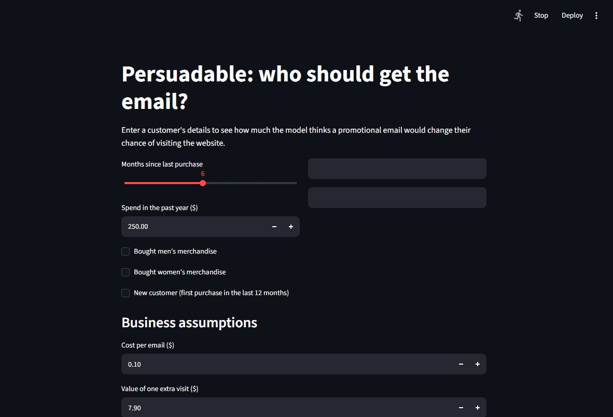

# Persuadable: who should get the email?

A causal analysis of a randomized email campaign: did the email work, who does it work for, and is it worth targeting? Built on the Hillstrom MineThatData experiment (about 43,000 customers).

**Short answer.** The promotional email generated a solid 4.5 percentage-point lift in site visits. While an S-Learner uplift model effectively prioritizes high-responding customers (delivering a 5.8 pp lift in its top deciles versus 3.6 pp overall), at a standard cost of $0.10 per email blanket emailing remains hard to beat. Targeting pays off once an email effectively costs about $0.30 or more, which is a gross margin below roughly 25–35% depending on the estimate (see the memo).



## The notebooks

Run them in order. Each one starts with a short note on what it reads and writes.

| # | Notebook | What it does and finds |
|---|---|---|
| 01 | `01_ingest_and_randomization` | Loads the data, keeps Women's email vs. no email, checks the 50/50 split (p = 0.70) |
| 02 | `02_balance_table` | Seven covariate tests with BH correction: no imbalance between groups |
| 03 | `03_ab_test` | Visits +4.5 points, purchases +0.31 points, spend +$0.42 per customer |
| 04 | `04_power_analysis` | Smallest detectable effect 0.85 points; 45 extra visits per 1,000 emails; break-even margin |
| 05 | `05_subgroup_heterogeneity` | New customers and recency matter, channel does not |
| 06 | `06_feature_engineering` | One-hot encoding and a 70/30 split stratified by treatment |
| 07 | `07_baseline_model` | A plain response model (AUC 0.615) and why it cannot answer the question |
| 08 | `08_t_learner` | Two XGBoost models, one per arm; predictions are wide and noisy |
| 09 | `09_s_learner` | One XGBoost model with treatment as a feature |
| 10 | `10_model_evaluation` | Qini AUC 0.045 vs. 0.018: the S-Learner wins |
| 11 | `11_bucket_sort` | Top half of the ranking shows +5.8 points; the four bucket labels do not hold up |
| 12 | `12_policy_evaluation` | Policies scored on realized outcomes; cost sweep with bootstrap intervals |

The decision write-up is in [`reports/decision_memo.md`](reports/decision_memo.md).

## Key results

| Policy at $0.10 per email | Customers emailed | Realized lift | Net value per 1,000 customers |
|---|---|---|---|
| Email everyone | 100% | 3.6 points | $184 |
| Email the model's picks | 70% | 4.2 points | $163 |

The $21 difference is within noise (95% interval -$69 to +$25). As the cost per email rises, emailing everyone stops paying at about $0.28, and from $0.30 the model's list clearly does better. Dollar figures are revenue, not profit; a lower margin acts like a higher email cost.

## Choices worth knowing about

- **Two arms only.** The Men's email arm is dropped so the comparison is a clean treatment vs. control.
- **Visits are the modeling target, not purchases.** Purchases happen in under 1% of customers (189 vs. 122 buyers), too few for a stable model. Purchases and spend are still tested.
- **Policies are scored with realized outcomes.** The test set is randomized, so the treated-minus-control difference inside any group is a causal estimate. Scoring a policy with the model's own predictions would always favor targeting.
- **Predicted sizes are not trustworthy, the ranking is.** The model's top-rated bucket was predicted at about +12 points and showed about +3.

## Run it

```bash
git clone https://github.com/Aria-vis/persuadable.git
cd persuadable
python -m venv .venv
.venv\Scripts\activate          # macOS/Linux: source .venv/bin/activate
pip install -r requirements.txt
streamlit run app/app.py
```

The trained models and the train/test split are committed, so the app runs straight away. To rebuild everything, run the notebooks in order: notebook 01 downloads the raw data and creates the SQLite file (both are git-ignored).

## Repo layout

```
notebooks/   01 to 12, run in order
models/      trained models and the saved winner
data/        train.parquet and test.parquet (the raw data is rebuilt by notebook 01)
app/         Streamlit demo
reports/     decision memo
```

## Limitations

Two weeks of outcomes from one retailer. The winning model and the policy comparison use the same test set, so the comparison is slightly optimistic for the model. The figures assume an extra visit is worth the average visitor's spend and are revenue, not profit. A top-k% cutoff was not tested.

## Path to production

- **Keep a random holdout.** Always withhold a small random group (say 10%) from the email, so the model can be checked against real outcomes.
- **Watch for fading response.** Track the weekly lift among emailed customers against the holdout. Email response often drops as customers get used to it.
- **Watch the inputs.** Compare the mix of recency, spend, new customers and channel against the training data and flag shifts.
- **Retrain on a schedule.** Re-run the experiment and refit roughly every quarter, or sooner if the holdout lift or the ranking quality (Qini AUC on fresh data) drops.

## Data

Hillstrom MineThatData E-Mail Analytics challenge, loaded through the `scikit-uplift` package.
